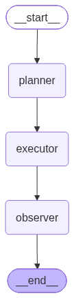
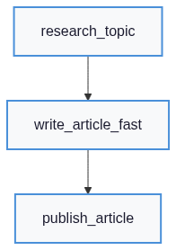
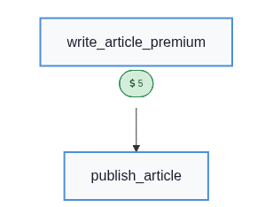

<div align="center">
  <a href="https://github.com/LangGOAP/LangGOAP">
    <picture>
      <source media="(prefers-color-scheme: dark)" srcset="https://raw.githubusercontent.com/LangGOAP/LangGOAP/main/.github/images/logo-dark.svg">
      <source media="(prefers-color-scheme: light)" srcset="https://raw.githubusercontent.com/LangGOAP/LangGOAP/main/.github/images/logo-light.svg">
      
    </picture>
  </a>
</div>

<div align="center">
  <h3>Goal-oriented planning for LangGraph agents.</h3>
</div>

<div align="center">
  <a href="https://github.com/LangGOAP/LangGOAP/blob/main/LICENSE" target="_blank"></a>
  <a href="https://pypi.org/project/langgoap/" target="_blank"></a>
  <a href="https://github.com/LangGOAP/LangGOAP/blob/main/pyproject.toml" target="_blank"></a>
  <a href="https://pepy.tech/projects/langgoap" target="_blank"></a>
  <a href="https://github.com/LangGOAP/LangGOAP/actions/workflows/test.yml" target="_blank"></a>
  <a href="https://github.com/LangGOAP/LangGOAP/actions/workflows/docs.yml" target="_blank"></a>
  <a href="https://gist.github.com/bsbodden/a3f945dce7217013798b24206fb5cd64" target="_blank"></a>
  <a href="https://github.com/bsbodden/mfcqi" target="_blank"></a>
</div>

<br>

LangGOAP turns a goal and a set of LangChain tools into a compiled `StateGraph` that plans before it acts, replans on failure, and stays deterministic by default. The planner is classical [A*](https://en.wikipedia.org/wiki/A*_search_algorithm) with optional OR-Tools CP-SAT refinement; the runtime is plain LangGraph, so checkpointing, streaming, `interrupt()`, and LangSmith all just work.

```bash
pip install -U langgoap
```

> [!TIP]
> For developing, debugging, and deploying agents, see [LangSmith](https://docs.langchain.com/langsmith/home). LangGOAP ships a `LangSmithTracer` that maps plan / replan / goal-achieved events to LangSmith runs alongside LangGraph's automatic node-level tracing.

## Why LangGOAP?

LangGOAP provides a planning layer for *any* agent that has to choose tools in a particular order under hard constraints:

- **Deterministic planning** — A classical A* search over your action set produces a checked plan before any tool runs; the same inputs always yield the same plan.
- **Constraint optimization built in** — Hard resource caps, soft objectives, temporal `IntervalVar` scheduling, and multi-plan Pareto selection via OR-Tools CP-SAT.
- **The plan _is_ a `StateGraph`** — Every plan compiles to a real LangGraph graph, so checkpointers, stores, streaming, `interrupt()`, and LangSmith all just work.
- **Replans automatically** — When an action fails, the world drifts, or a sensor invalidates a precondition, the executor blacklists the offender and the planner picks a new path without any routing code.
- **LLM where it earns its keep** — Natural-language goals are parsed once by `GoalInterpreter`; the loop itself stays symbolic. No ReAct, no agentic reasoning between tool calls.

### In Plain English...

You hand LangGOAP a goal in plain English and a bag of tools, and an LLM reads the goal exactly once to turn it into a symbolic target — that's the only place a model gets to make decisions. From there, a classical A* search picks the shortest sequence of tool calls that reaches the goal, and because the search is deterministic, the same goal and the same tools always produce the same plan. If you've declared resource caps, scheduling windows, or objectives to optimize, those are handed to OR-Tools CP-SAT to refine the plan against real constraints, all without extra wiring. The plan then compiles down to an ordinary LangGraph `StateGraph`, so checkpointing, streaming, `interrupt()`, LangSmith tracing, and everything else in the LangGraph ecosystem work the way you'd expect. When execution hits the real world and something breaks — a tool errors out, a precondition no longer holds, an external sensor disagrees — the executor blacklists the offending action and asks the planner for a new path, so recovery happens automatically rather than through hand-written routing code.

> [!TIP]
> See [`examples/screencast/research_agent/`](examples/screencast/research_agent/) for a head-to-head comparison of `create_react_agent`, a hand-wired `StateGraph`, and LangGOAP — same brief, same tools, real OpenAI + Tavily costs, a revoked API key as the climax.

## Quickstart

The snippet below wraps four LangChain tools and asks LangGOAP to publish an article. The LLM parses the natural-language goal exactly once into a symbolic target like `{"published": True}`, and from there A* takes over. The `preconditions` and `effects` dictionaries describe how each tool changes the world: a writer can only run once `have_brief` is true, and `research_topic` is what makes `have_brief` true in the first place. Two writers compete to satisfy the `have_draft` precondition — `write_article_fast` at `cost=1.0` and `write_article_premium` at `cost=5.0` — and A* picks the cheaper one. If the cheap writer fails at execution time, the executor blacklists it and the planner re-derives a fresh plan through the premium writer without any routing code on the caller's side. The `costs={...}` mapping is what makes that trade-off explicit; omitted tools default to `cost=1.0`, and the same numbers feed directly into the CSP layer when you want hard resource budgets like `cost_usd` or `tokens` — see [`examples/screencast/research_agent/`](examples/screencast/research_agent/) for that. Finally, `result_keys` plumbs each tool's return value into `world_state` under a chosen key, so `research_topic`'s output lands at `world_state["brief"]` where the next tool's `brief` argument can pick it up — the initial `world_state` only needs to seed the first tool's argument (`topic`).

```python
from langchain_core.tools import tool
from langchain_openai import ChatOpenAI
from langgoap import create_goap_agent, rehydrate_state

# A small counter so the demo can simulate the cheap writer flaking out
# on its first N invocations.  Flip `fail_fast_n_times` to 1 to see the
# planner replan through the premium writer.
def make_writers(fail_fast_n_times: int = 0):
    state = {"fast_calls": 0}

    @tool
    def write_article_fast(brief: str) -> str:
        """Quickly draft an article from a brief. Cheaper, occasionally flaky."""
        state["fast_calls"] += 1
        if state["fast_calls"] <= fail_fast_n_times:
            raise RuntimeError(f"upstream rate limit (attempt {state['fast_calls']})")
        return f"Fast draft: {brief}"

    @tool
    def write_article_premium(brief: str) -> str:
        """Premium-quality article. Higher cost, always reliable."""
        return f"Premium draft: {brief}"

    return write_article_fast, write_article_premium

@tool
def research_topic(topic: str) -> str:
    """Produce a short research brief for a topic."""
    return f"Brief on {topic}"

@tool
def publish_article(draft: str) -> str:
    """Publish an article draft."""
    return f"Published: {draft}"

write_article_fast, write_article_premium = make_writers(fail_fast_n_times=0)

agent = create_goap_agent(
    tools=[research_topic, write_article_fast, write_article_premium, publish_article],
    goal="Publish an article about GOAP for LangGraph",
    llm=ChatOpenAI(model="gpt-4o-mini", temperature=0),
    # Preconditions/effects keep the planner honest — never LLM-inferred.
    preconditions={
        "write_article_fast":    {"have_brief": True},
        "write_article_premium": {"have_brief": True},
        "publish_article":       {"have_draft": True},
    },
    effects={
        "research_topic":        {"have_brief": True},
        "write_article_fast":    {"have_draft": True},
        "write_article_premium": {"have_draft": True},
        "publish_article":       {"published":  True},
    },
    # A* minimizes total cost. Omitted tools default to cost=1.0.
    costs={
        "research_topic":        1.0,
        "write_article_fast":    1.0,
        "write_article_premium": 5.0,
        "publish_article":       1.0,
    },
    # Wire each tool's return value into the next tool's input.
    result_keys={
        "research_topic":        "brief",
        "write_article_fast":    "draft",
        "write_article_premium": "draft",
    },
)

result = agent.invoke(
    {
        "world_state": {"topic": "GOAP for LangGraph"},
        "goal": agent.goap_goal,
    }
)
# A compiled graph returns plain JSON state (so any checkpointer can store it);
# rehydrate it to get Plan and ActionResult objects back.
result = rehydrate_state(result, agent.goap_actions)
```

`agent` is a compiled LangGraph graph. Use it with streaming,
checkpointers, `interrupt()`, or any LangGraph feature. The
LangGraph cycle that `create_goap_agent` compiles to is small and
fixed — every plan flows through the same `planner → executor →
observer` loop:

<p align="center">
  
</p>

### Scenario 1 — Happy path (cheap writer wins on cost)

A* sees two paths to `have_draft: True` and picks the cheaper one:

<p align="center">
  
</p>

```text
status:              'goal_achieved'
replan_count:        0
blacklisted_actions: []
plan.action_names:   ['research_topic', 'write_article_fast', 'publish_article']
plan.total_cost:     3.0
execution_history:
   1. [ok ] research_topic
   2. [ok ] write_article_fast
   3. [ok ] publish_article
world_state (relevant keys): {'topic': 'GOAP for LangGraph', 'brief': 'Brief on GOAP for LangGraph', 'draft': 'Fast draft: Brief on GOAP for LangGraph'}
```

### Scenario 2 — Cheap writer flakes, planner replans through premium

Set `fail_fast_n_times=1` and run again. `write_article_fast` raises on its first call, the executor blacklists it, and the observer hands control back to the planner. A* re-derives a new plan from the current world state (`have_brief` is already `True` because `research_topic` succeeded), so the remaining work is just the premium writer plus publish:

<p align="center">
  
</p>

```text
status:              'goal_achieved'
replan_count:        1
blacklisted_actions: ['write_article_fast']
plan.action_names:   ['write_article_premium', 'publish_article']
plan.total_cost:     6.0
execution_history:
   1. [ok ] research_topic
   2. [FAIL] write_article_fast  (upstream rate limit (attempt 1))
   3. [ok ] write_article_premium
   4. [ok ] publish_article
world_state (relevant keys): {'topic': 'GOAP for LangGraph', 'brief': 'Brief on GOAP for LangGraph', 'draft': 'Premium draft: Brief on GOAP for LangGraph'}
```

## Three ways to use it

LangGOAP ships three on-ramps so you can adopt as much or as little as
you need without rewriting your action definitions.

- **`create_goap_agent`** — Natural-language goal plus LangChain tools.
  The shortest path. Used in
  [`examples/tutorials/deep_research_agent.ipynb`](examples/tutorials/deep_research_agent.ipynb).
- **`goapify_tool` / `GoapGraph`** — Hand-authored `ActionSpec` objects
  with explicit preconditions, effects, costs, and validators. The
  workhorse API used by every tutorial. Tier 1 primer:
  [`examples/tutorials/directory_handler.ipynb`](examples/tutorials/directory_handler.ipynb).
- **`GoapSubgraph` / `add_goap_subgraph`** — Drop a GOAP loop into an
  existing `StateGraph` as a sealed node. Useful when GOAP is one
  reasoning mode among many. Quickstart:
  [`examples/basics/goap_subgraph.ipynb`](examples/basics/goap_subgraph.ipynb).

All three on-ramps accept the same `GoapGraph` options (`tracer`,
`strategy`, `history`, `sensors`, `guards`, `resolvers`,
`transition_model`, `stuck_handlers`, `termination_policies`, …), so
nothing forces a rewrite to the full API as a project grows.
`goapify_tool` exposes every declarative `ActionSpec` field, and
`create_goap_agent` takes per-tool maps for `qos`,
`require_human_approval`, `human_input_key`, `can_rerun`, `read_only`,
`utility` and `metadata`; the compiled agent carries `goap_goal` and
`goap_actions` so a JSON result can be rehydrated with
`rehydrate_state(result, agent.goap_actions)`. `add_goap_subgraph`
registers sync and async node variants and forwards the parent's
`RunnableConfig`, so a parent checkpointer, callbacks and
human-approval interrupts work inside the sub-graph.

## Features

### Planning

- **Cost-aware planner** — finds the cheapest sequence of tool calls that reaches your goal, using a classical A* search over the action set. You supply per-action costs, optional effect validators that double-check what each tool actually changed, and per-action retry budgets.
- **Constraint-aware refinement** — when the goal carries hard caps (budgets, time windows) or objectives to minimize/maximize, the candidate plan is handed to OR-Tools CP-SAT, which refines or replaces it to satisfy them. Preferences (objectives, soft constraints, soft goals) compare the A\* plan against alternative plans and pick the best one, with total cost as the tie-breaker; a plan that violates a hard cap is reported as `no_plan` with the resource shortfalls unless the goal opts in with `GoalPolicy(on_infeasible="execute")`.
- **Pluggable strategies** — A* is the default, but the `PlanningStrategy` Protocol lets you swap in Monte-Carlo Tree Search (`MCTSStrategy`, better for stochastic worlds), constraint-first solving (`CSPRefinementStrategy`), utility-based ranking (`UtilityStrategy`), interruptible "best plan so far" search (`AnytimePlanningStrategy`), or in-place repair after execution failures (`RepairStrategy`).
- **Automatic strategy selection** — `StrategyRouter` inspects the problem (hard constraints, stochasticity, branching factor) and dispatches to the right strategy. Routing is a pure function of the problem, so the same inputs always pick the same strategy.
- **Expected-value vs. sampled dynamics** — a `TransitionModel` separates *declared* effects (what a tool says it changes) from *sampled* effects (what actually happens). The planner reasons about expected outcomes while MCTS rollouts and the graph runtime see the real sampled world.

### Constraints and scheduling

- **Plan scoring** — rank candidate plans by a single number (`SimpleScore`), by feasibility-first hard/soft tradeoffs (`HardSoftScore` — hard violations make a plan infeasible, soft scores rank the survivors), or by weighted priority levels (`BendableScore`). All three compare lexicographically and share a consistent penalize/reward sign convention.
- **Declarative constraints** — a fluent `ConstraintBuilder` API for resource caps, soft objectives, and weighted penalties, e.g. `for_each_action().where(...).sum_resource("gpu_hours").bounded(max=budget)`. No solver code required.
- **Temporal scheduling** — when actions have durations and deadlines, LangGOAP solves a scheduling problem alongside the plan: every action becomes a CP-SAT `IntervalVar`, precedence comes from the dependency graph, and the solver minimizes makespan. The resulting schedule renders as a Gantt chart from `CSPMetadata.schedule`.

### LangGraph-native execution

- **The plan _is_ a `StateGraph`** — `GoapGraph` compiles a real LangGraph graph with planner / executor / observer nodes. Each node has sync and async variants so tracer hooks fire from both `.invoke()` and `.ainvoke()`.
- **Replanning memory** — `StoreExecutionHistory` persists each step's outcome in any LangGraph `BaseStore` (`InMemoryStore`, `AsyncPostgresStore`, your own). Keyed by tool name, so the planner can avoid actions that already failed in this run. No vector embeddings required.
- **Multi-goal decomposition** — `MultiGoal` sequences a list of subgoals into a single executable plan, in `sequential` order (strict: an unreachable stage ends the run with `no_plan`; opt into `on_infeasible="skip"` to continue and finish `partial`), `any`-of mode (succeed when any subgoal is satisfied), or `best_value` mode.
- **Plan visualization** — render any plan as a Mermaid diagram (`render_mermaid`), Gantt chart (`render_mermaid_gantt`, `render_ascii_gantt`), GraphViz DOT graph (`render_dot`), or ASCII tree (`render_ascii`); `visualize` is the top-level dispatcher. Pure Python — no binary dependencies for Mermaid or ASCII output.

### Reliability and recovery

- **Per-action retry and idempotency** — `ActionQos` declares the retry policy and idempotency hints for each action (`FIRE_ONCE` for actions that must never repeat, `can_rerun` for safe retries, `read_only` for actions that don't mutate the world).
- **Predictable failure handling** — a failed action is retried up to `ActionSpec.max_retries` times and then blacklisted, and the planner routes around it. When no path to the goal remains, the run ends with `status="no_plan"` and an explanation naming the blacklisted actions and the knobs that would unblock it; `GoalPolicy(blacklist_fallback=True)` opts back into re-admitting the failed action and planning through it again.
- **Human-in-the-loop approval** — `require_human_approval` pauses execution at a chosen action and asks for input via LangGraph's `interrupt()`. Pass a Pydantic `BaseModel` to collect a typed form (validated on resume) or `True` for a plain approve/deny gate.
- **Stuck handlers** — when planning fails to find a path, `MulticastStuckHandler` runs an ordered chain of recovery handlers that can patch the world state, swap in a relaxed goal, or escalate to a human. The first handler that returns `REPLAN` wins.
- **Early-termination policies** — stop a run that's getting too expensive or running too long: cap by dollars (`MaxCostPolicy`), wall-clock time (`MaxWallClockPolicy`), LLM calls (`MaxLLMCallsPolicy`), tokens (`MaxTokensPolicy`), or actions executed (`MaxActionsPolicy`). Combine them with `FirstOfPolicy` (any cap trips) or `AllOfPolicy` (all caps must trip).

### Observability

- **Pluggable tracing** — `PlanningTracer` is a Protocol with sync and async hooks (`on_plan_complete`, `on_action_retry`, `on_strategy_chosen`, …). `NullTracer`, `LoggingTracer`, `MultiTracer`, and `LangSmithTracer` ship in-tree; custom tracers (OpenTelemetry, Prometheus, …) are ordinary classes that implement the protocol. Tracer exceptions never propagate into the planner.
- **Live cost accounting** — `CostAccumulator` (with `DEFAULT_COST_PER_1K_TOKENS` for common models) tracks LLM token usage and dollar cost in real time, plumbed into world state so `MaxCostPolicy` and the `cost_bounded_research_agent` tutorial can enforce hard budgets mid-run.

### Checkpointing

- **Resume from anywhere** — pause a run (because of an `interrupt()`, a crash, or a deliberate stop) and resume it later from the saved checkpoint. The graph state is plain JSON (`GoapStateChannels`), so **any** LangGraph checkpointer works with its stock serializer and LangGOAP ships no serializer of its own; in-memory (`MemorySaver`), Postgres (`PostgresSaver` / `AsyncPostgresSaver`), and Redis (`RedisSaver` / `AsyncRedisSaver`) are tested. The backend extras are plain pass-throughs: `pip install langgoap[checkpoint-postgres]` or `pip install langgoap[checkpoint-redis]`. Because LangGraph persists the raw input, build a checkpointed run's input with `GoapGraph.initial_state(goal, world_state)` (or pass `goal.to_dict()`), and turn a compiled graph's JSON result back into `Plan` / `ActionResult` objects with `GoapGraph.rehydrate(result)`; `GoapGraph.invoke` does both for you.

### Natural-language goals

- **Describe goals in plain English** — `GoalInterpreter` parses a natural-language request into a structured `GoalSpec` using any LangChain chat model that supports structured output. `GoapGraph.invoke_nl(request, llm=...)` (and its async twin `ainvoke_nl()`) accept the request as a plain string, so callers don't need to construct `GoalSpec` by hand.

### CLI and deployment

- **`langgoap` CLI** — inspect and run plans from the terminal: `plan` (search and print a plan without executing anything; add `--run` to execute it, `-s auto|astar|pipeline|mcts` to pick the strategy), `actions` (list discovered actions), `explain` (explain why an action was or wasn't picked), `visualize` (render a plan), and `deploy-init` (scaffold a deployment). Loads actions, goals, and world state from `module:variable` references so existing Python code can stay where it is.
- **LangGraph deployment scaffold** — `scaffold_deployment` (and `langgoap deploy-init`) generates a complete `langgraph dev`-ready directory in one command. Every `langgraph` deployment automatically serves an `/mcp` endpoint, so a LangGOAP graph becomes an MCP tool for any compatible client with no extra wiring.

### DeepAgents and tool interop

- **Use a LangGOAP graph as a LangChain tool** — `create_goap_tool` wraps a `GoapGraph` as a LangChain `StructuredTool` that a higher-level agent can call.
- **Use a LangGOAP graph as a Deep Agents sub-agent** — `create_goap_subagent` returns a `CompiledSubAgent`-compatible dict for [Deep Agents](https://github.com/langchain-ai/deepagents).
- Both wrappers run the request through `GoalInterpreter` first, so the calling agent only needs to send a natural-language string.

## Examples

The [`examples/`](examples/) directory holds three flavours of runnable
documentation.

- **[`examples/basics/`](examples/basics/)** — short primers that each
  exercise a single mechanic: quickstart, CLI, plan visualization,
  natural-language goals, tracing, termination policies, stuck
  handlers, typed-form HITL, action QoS, MCTS vs A* on stochastic
  domains.
- **[`examples/tutorials/`](examples/tutorials/)** — end-to-end
  walkthroughs in three tiers. Tier 1 introduces GOAP on toy domains;
  Tier 2 covers constraint-optimization workflows; Tier 3 showcases
  the full stack on substantial problems
  (`deep_research_agent`, `flexible_job_shop`, `supply_chain_disruption_mediator`,
  `code_review_agent_mcp_deployment`).
- **[`examples/screencast/`](examples/screencast/)** — the flagship
  YouTube companion lives at
  [`examples/screencast/research_agent/`](examples/screencast/research_agent/):
  four agents (`create_react_agent` baseline, hand-wired `StateGraph`,
  LangGOAP, LangGOAP-under-disruption) on the same brief with real
  OpenAI + Tavily costs and a Tavily-key revocation as the climax.
  Three hermetic case studies (incident, supply chain, travel) sit
  alongside it for vertical-specific walk-throughs.

Start with
[`examples/screencast/research_agent/`](examples/screencast/research_agent/)
to see GOAP replace a routing graph and survive a runtime disruption
in one sitting, or
[`examples/tutorials/directory_handler.ipynb`](examples/tutorials/directory_handler.ipynb)
if you are new to GOAP and want a smaller starting point.

## LangGraph ecosystem

LangGOAP integrates with the rest of the LangChain stack:

- **[LangGraph](https://docs.langchain.com/oss/python/langgraph/overview)** — the runtime substrate. Every LangGOAP plan compiles to a real `StateGraph` and works with streaming, checkpointing, and `interrupt()`.
- **[LangSmith](https://docs.langchain.com/langsmith/home)** — `LangSmithTracer` emits GOAP plan / replan / goal-achieved events to LangSmith alongside LangGraph's automatic node-level traces.
- **[LangGraph deployment](https://docs.langchain.com/langsmith/deployments)** — `langgoap deploy-init` scaffolds a `langgraph dev`-ready directory; the generated deployment serves an `/mcp` endpoint so a LangGOAP graph is callable from any MCP client (Claude Desktop, Cursor, …).
- **[Deep Agents](https://docs.langchain.com/oss/python/deepagents/overview)** — `create_goap_tool` and `create_goap_subagent` embed a LangGOAP graph as a tool or subagent inside a Deep Agents harness.

---

## Documentation

- [`examples/screencast/research_agent/`](examples/screencast/research_agent/) – Flagship walkthrough: ReAct vs. hand-wired `StateGraph` vs. LangGOAP on the same brief, with measured OpenAI + Tavily costs.
- [`examples/tutorials/`](examples/tutorials/) – End-to-end notebooks across three tiers (toy domains, constraint-optimization, full-stack).
- [`examples/basics/`](examples/basics/) – Short primers, one mechanic per notebook (CLI, visualization, NL goals, tracing, termination policies, stuck handlers, typed-form HITL, MCTS vs A*).
- [`langgoap/__init__.py`](langgoap/__init__.py) – Authoritative list of public symbols. Anything not re-exported from the top-level package is internal and subject to change.
- [Changelog](CHANGELOG.md) – Release notes for every public version.

## Contributing

```bash
uv sync
make check                                              # full lint + test suite
uv run pytest tests/integration/test_flexible_job_shop.py -vv
uv run pytest -m api                                    # requires OPENAI_API_KEY / ANTHROPIC_API_KEY
```

---

## Acknowledgements

LangGOAP is inspired by [GOAP](https://alumni.media.mit.edu/~jorkin/gdc2006_orkin_jeff_fear.pdf) (Jeff Orkin / F.E.A.R.) and [Embabel](https://github.com/embabel/embabel-agent), which first applied GOAP planning to agentic LLM workflows. The `Score` hierarchy and fluent `ConstraintBuilder` are adapted from [OptaPlanner](https://www.optaplanner.org/); the CSP pipeline is built on [OR-Tools CP-SAT](https://developers.google.com/optimization/cp/cp_solver); A* correctness was checked against [GOApy](https://github.com/leopoldmaillard/GOApy); and the action/effect model draws on [unified-planning](https://github.com/aiplan4eu/unified-planning). LangGOAP is built on [LangGraph](https://langchain-ai.github.io/langgraph/) by [Integrallis Software](https://integrallis.com), but can be used wherever LangChain tools are available.

## License

MIT. See [LICENSE](LICENSE).
